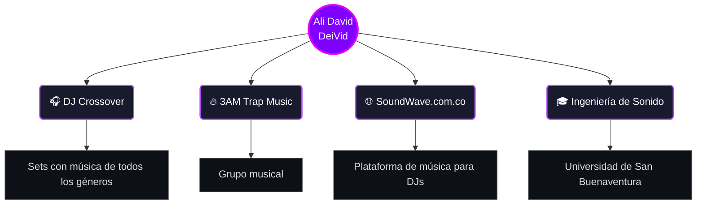

 

---

## 👤 Sobre mí

Soy **Ali David Moron**, conocido como **DeiVid**. Soy DJ crossover: en mis sets mezclo todos los géneros para que nadie se quede quieto. Pertenezco a **3AM Trap Music** y soy owner de **SoundWave.com.co**, una plataforma de música para DJs.

Estudio **Ingeniería de Sonido** en la **Universidad de San Buenaventura**, sede San Benito. Music is my life

---

## 🗺️ Mi mundo

---

## 🎚️ Mis proyectos

| Proyecto | Qué es | Mi rol |
| :---: | --- | :---: |
| 🎧 **DJ Crossover** | Variadito para que se lo gozen | DJ |
| 🔥 **3AM Trap Music** | Grupo musical | Integrante |
| 🌐 **SoundWave.com.co** | Plataforma de música para DJs | Owner |
| 🎓 **Ingeniería de Sonido** | Mi carrera universitaria | Estudiante |

---

## 🛠️ Herramientas que uso

## 📚 Aprendiendo

---

## 📫 Dónde encontrarme

 

**Hecho por DeiVid 🎶**

